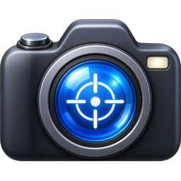

<p align="center"></p>
<h1 align="center">PageShot</h1>
<p align="center">Capture. Copy. Done.</p>

A Chrome extension for full-page screenshots, with a small popup and a simple crop editor. Built with WXT, Svelte 5, TypeScript, and pnpm.

## Install in Chrome

Build the extension from source using the [development commands](#develop). The build creates `.output/chrome-mv3`. Running `nice -n 10 pnpm zip` creates `.output/pageshot-0.1.0-chrome.zip`; unzip it before loading.

1. Open `chrome://extensions/`.
2. Enable **Developer mode**.
3. Click **Load unpacked** and select this project's `.output/chrome-mv3` folder.
4. Pin **PageShot** in Chrome's extensions menu.

In the macOS folder picker, press **⌘⇧G** and paste the full folder path. Alternatively, **⌘⇧.** shows hidden folders.

After rebuilding, click **Reload** on PageShot at `chrome://extensions/`.

## Use

- Open the popup, choose **Full page** or **Visible area**, and click **Take screenshot**.
- Click **Copy** to put the PNG on your clipboard, **Download** to save it, or **Crop / edit** to open the editor.
- In the editor, drag a rectangle or enter its pixel coordinates, then **Apply selection**. Choose **Crop** or **Cover in black**. **Reset** restores the original. Copy and download export the edited image.
- Capture errors are shown once and can be dismissed. Starting another capture clears the message.
- You can close the popup during capture and reopen it for the result. The latest screenshot remains until you replace it or click **Clear**. Opening the popup on another page still shows that last capture.

Full-page capture scrolls through the document, waits for each visible section to paint, and stitches viewport screenshots. Fixed overlays appear only on the first tile; sticky elements stay in their document positions. PageShot restores the original scroll position and styles afterward, including on failure. Keep the page still during capture. Chrome shows a brief debugging banner; close the page’s DevTools first.

## Privacy and permissions

No account, telemetry, screenshot uploads, external scripts, or remote fonts. Captures stay on your device in the extension's IndexedDB. There is no screenshot history. Starting another capture replaces the previous screenshot, even if the new capture fails. Clearing removes the stored capture; editor tabs already holding it and downloaded files remain separate copies. Uninstalling removes extension storage.

| Permission | Purpose |
| --- | --- |
| `activeTab` | Identify the page when you open PageShot. |
| `debugger` | Obtain page dimensions and capture it through Chrome's screenshot protocol. Used during capture, then detached. This is a powerful permission and Chrome displays a corresponding installation warning. |
| `clipboardWrite` | Copy PNG screenshots when you click Copy. |

No persistent website host permissions, background page scanning, or download-manager access. Screenshot content can include anything rendered on the page; check it before sharing.

## Capture boundaries

- Supports ordinary HTTP and HTTPS pages and local HTML files. For local files, enable **Allow access to file URLs** in PageShot's **Details** at `chrome://extensions/`. Chrome internal pages, Chrome Web Store pages, PDFs in Chrome's viewer, and extension pages are outside this version's scope.
- Captures the current document, with a brief wait for visible lazy images at each scroll step. PageShot first scrolls through lazy sections, then captures them. If the document changes size during stitching, it automatically redraws from the top. Capture stops after 60 seconds if the page keeps changing. Infinite-scroll content and content hidden inside separately scrollable panels are not expanded. CSS animations are paused during full-page capture. Video reflects each captured frame; protected media may be blank.
- Full-page images automatically reduce resolution when needed to stay below 30,000 output pixels per side and 80 megapixels. The entire page is preserved, but text on very long pages becomes smaller. Retina displays and page zoom affect output size. Reset pinch zoom before capturing.
- Popup metadata reports the PNG's actual dimensions. The editor works in output pixels.
- Crop and black covering are the only editing tools. There is no annotation suite or undo stack; Reset restores the original. Export flattens edits into PNG pixels.

## Develop

Requires Node.js 22.12+, pnpm 10, and Chrome 121+.

```sh
nice -n 10 pnpm install --frozen-lockfile
nice -n 10 pnpm check
nice -n 10 pnpm lint
nice -n 10 pnpm test
nice -n 10 pnpm build
nice -n 10 pnpm test:e2e
nice -n 10 pnpm zip
```

Install Chrome for Testing with `nice -n 10 pnpm exec playwright install chromium` if needed. Browser tests use a disposable profile with synthetic fixture pages and one worker; they do not alter your browser or system clipboard. Build before running E2E tests.

`nice -n 10 pnpm dev` selects a free port and records it in `.env.dev-slot`. The browser is not launched automatically. Stop the server when finished.

```text
src/entrypoints/   Background capture worker, popup, full-tab editor
src/lib/           Capture lifecycle, image helpers, latest-capture store
src/assets/        Shared UI styles
public/icons/      Transparent toolbar icons
scripts/           Free-port development launcher and icon exports
tests/            Unit tests
e2e/              Isolated Chrome integration test
```

See [verification](docs/verification.md) for tested behavior and remaining manual checks, and [icon source](docs/assets/icon-source.md) for the generated asset prompt. Application code is original; CocoShot was a feature reference. MIT licensed.

## Contribute

See [CONTRIBUTING.md](CONTRIBUTING.md) for setup, checks, and the pull request workflow.
